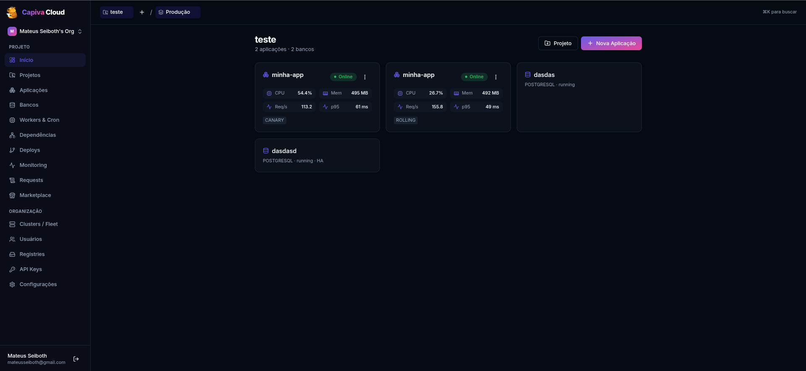
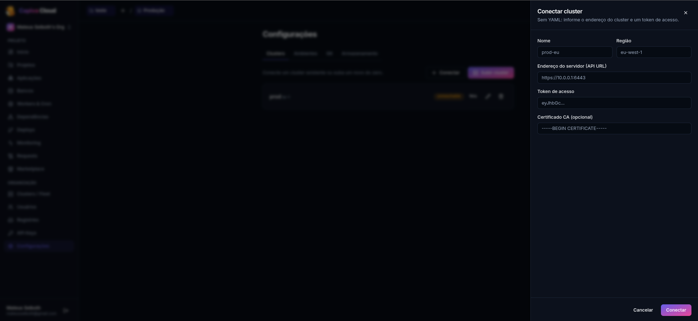
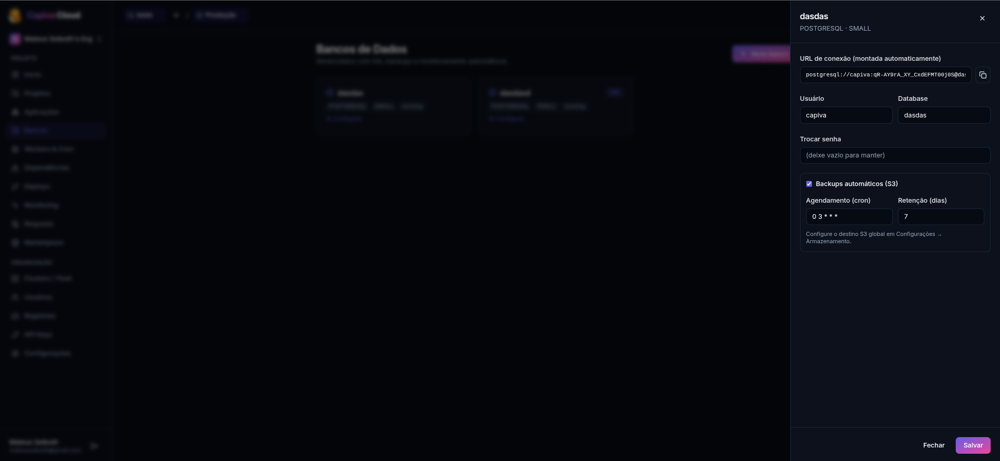
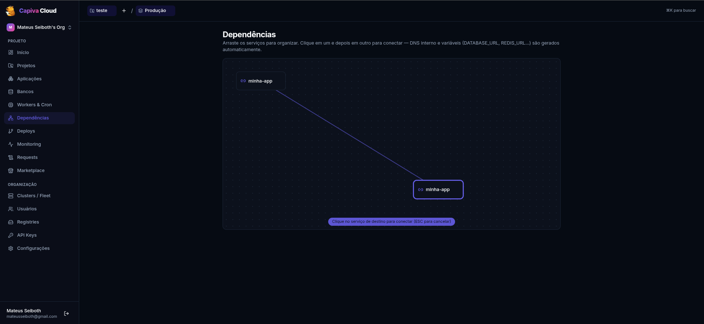

<div align="center">
  

# Capiva Cloud

### Kubernetes without Kubernetes

Deploy applications, databases, workers and cron jobs through a visual interface. No YAML, no kubectl, and no Kubernetes expertise required.

</div>

## App Preview

<p align="center">
  
</p>

<p align="center">
  
</p>

<p align="center">
  
</p>

<p align="center">
  
</p>

---

## ✨ What is Capiva Cloud?

**Capiva Cloud** is a deployment platform built on top of a multi-cluster Kubernetes infrastructure.

The goal is simple: create your project using a guided setup wizard, choose what you need, and let the platform handle everything else.

Instead of dealing with deployments, networking, storage, certificates, scaling and cluster operations, you simply configure your application through the UI and Capiva Cloud takes care of the underlying infrastructure.

During project creation, you can select:

- Git repository
- Application type
- Database services
- Domains
- Resource profiles
- Deployment preferences

Once the setup is complete, Capiva Cloud automatically provisions, configures and manages the required infrastructure.

SSL certificates, networking, storage, backups, scaling, monitoring and service connectivity are handled automatically behind the scenes.

The capybara represents what the platform aims to be: calm, reliable infrastructure that simply works.

## 🎯 Who is it for?

Capiva Cloud is designed for developers, startups and small teams that want to deploy production-ready applications without becoming Kubernetes experts.

Focus on building software. Let the platform handle the infrastructure.

## 🧩 Key Features

- Deploy applications from GitHub, GitLab, Gitea or Docker images.
- Guided project creation wizard inspired by tools like Dokploy.
- Automatic stack detection and build configuration.
- Simple resource profiles (Nano, Small, Medium, Large and XLarge).
- Automatic scaling when needed.
- Custom domains with automatic TLS provisioning.
- One-click service marketplace.
- Managed databases with high availability and automated backups.
- Automatic service discovery and application integration.
- Continuous deployment from Git repositories.
- Automatic rollback support.
- Zero-downtime deployment strategies.
- Built-in logs and metrics.
- Organizations, teams and environments.
- Multi-cluster architecture.
- Secure by default.
- Real builds for every source: Dockerfile (Kaniko), Nixpacks, Railpack, Cloud Native Buildpacks, static sites and Docker Compose services.
- Preview deployments per pull request, with the URL commented on the PR and automatic cleanup.
- Deploys triggered by branch push, tag or release, with commit status reported back to GitHub, GitLab and Gitea.
- Vulnerability scan of every image with Trivy, with an optional policy that blocks critical or high CVEs.
- Metric alerts (CPU, memory, 5xx rate, p95 latency) plus downtime, recovery and rollback notifications.
- Log search with text, regex, level, pod and time filters, shareable links and download.
- One-click restore of database and volume backups, in place or as a copy.
- Default NetworkPolicy isolation per environment and env vars from external vaults (External Secrets).
- Per-environment quotas and estimated monthly cost per app, project and organization.
- Infrastructure as code with `capiva.json` and the `capiva` CLI.

### Distributed Storage

Persistent storage is powered by **Longhorn**.

Volumes are automatically replicated across cluster nodes, providing high availability, resilience and reliable storage for applications, databases and internal platform services.

## 🏗️ Architecture

```text
capiva-cloud/
├── backend/    # Bun + Express + @mateusseiboth/ts-decorators + Prisma 7
├── frontend/   # React + TanStack Query + Zustand + React Hook Form + Zod
├── mobile/     # Expo (Expo Go) + NativeWind + React Native Reusables
├── cli/        # `capiva` command-line tool (Bun, compiled to a single binary)
└── docs/       # Architecture, workflows and technical documentation
```

The platform is composed of three main layers:

- **Frontend** responsible for the user experience.
- **Backend** responsible for business logic, authentication and infrastructure orchestration.
- **Reconciliation Engine** responsible for keeping clusters aligned with the desired project state.

All Kubernetes complexity remains hidden from end users.

## 🚀 How It Works

1. Create a new project.
2. Follow the setup wizard.
3. Choose your repository, services, domains and resources.
4. Click deploy.

Capiva Cloud provisions and configures everything automatically.

Whenever new code is pushed to your repository, the platform can build, deploy and roll back changes automatically according to your deployment settings.

No Kubernetes manifests, no kubectl commands and no cluster administration required.

## 📦 Self-hosting the control plane (Docker)

`docker-compose.yml` is the local development stack (ports 3000/5173/5432/9000, CORS pointing at `localhost`).
To run the control plane on a server, use `docker-compose.deploy.yml`:

```bash
cp .env.deploy.example .env      # set PUBLIC_HOST, ports and generate the secrets
docker compose -f docker-compose.deploy.yml up -d --build
```

| Variable | Default | Description |
| --- | --- | --- |
| `PUBLIC_HOST` | — | Host/IP used to reach the panel (feeds the web terminal WebSocket URL) |
| `PANEL_PORT` | `8410` | Published port of the panel |
| `API_PORT` | `8411` | Published port of the API (direct access and Scalar docs at `/docs`) |
| `POSTGRES_PASSWORD` | — | Password of the dedicated control plane Postgres |
| `ENCRYPTION_KEY` | — | 32-byte hex key for credential encryption at rest |
| `JWT_PRIVATE_KEY` / `JWT_PUBLIC_KEY` | — | RS256 PEM pair signing access tokens (**required in production**) |
| `MINIO_ROOT_USER` / `MINIO_ROOT_PASSWORD` | — | Credentials of the dedicated MinIO (backups/uploads) |
| `ORIGIN_WHITELIST` | empty in prod | Extra CORS origins, comma-separated |
| `CAPIVA_K8S_INSECURE_TLS` | `false` | Accept self-signed certs **only** on Kubernetes API server calls |

Optional settings for previews (`CAPIVA_PREVIEW_DOMAIN`, `CAPIVA_PREVIEW_TTL_DAYS`), commit status links
(`PUBLIC_URL`), cost estimates (`CAPIVA_PRICE_*`) and the build, scan and restore images are listed in
[docs/20 — Environment variables](./docs/20-variaveis-de-ambiente.md) and in each feature's doc (34 to 44).

> ⚠️ **Before running in production**, read [docs/32 — Hardening](./docs/32-hardening-producao.md).
> Two steps are mandatory: rotate the JWT key pair (the previous private key was committed
> to this repository's history) and replace the example `ENCRYPTION_KEY` — the backend
> refuses to start in production with the placeholder value.

The stack ships four containers: `capiva-postgres` and `capiva-minio` (dedicated, **not** published to the
host network), `capiva-backend` and `capiva-frontend`.

Two details matter when deploying:

- **Panel and API share a single origin.** `frontend/nginx.deploy.conf` proxies `/api`, `/docs` and
  `/terminal` (WebSocket) to the backend, because `ORIGIN_WHITELIST` in `backend/src/http/server.ts` is
  hardcoded to `localhost` and the refresh cookie uses `sameSite=strict`.
- **`VITE_API_URL` is resolved at build time.** It is passed as a build arg in `frontend/Dockerfile.deploy`
  and defaults to empty, so the client issues relative `/api` requests. Setting it as a runtime environment
  variable has no effect.

`backend/Dockerfile.deploy` runs `prisma migrate deploy` before starting the API, so the schema is applied
on every rollout.

## 🛠️ Development tooling

All packages use TypeScript 7, **oxlint** for linting and **oxfmt** for formatting (no ESLint or
Prettier). From the repository root:

```bash
bun run typecheck      # backend, frontend and cli
bun run lint           # oxlint in backend (type-aware), frontend and mobile
bun run format:check   # oxfmt --check in every package (bun run format to fix)
bun run test           # backend, cli, frontend and mobile tests
```

Database changes always go through Prisma migrations (`bun run prisma:migrate`), never `db push`.
See [docs/18 — Dev environment](./docs/18-dev-environment.md).

## ⌨️ CLI and `capiva.json`

Declare an application's build, resources, scaling, env vars, volumes and domains in a
`capiva.json` at the repository root. It is read at the deployed commit and wins over the panel for
the fields it declares. Drive the platform from the terminal with an API key (`cap_...`):

```bash
bun run build:cli                  # compiles cli/ into a single binary
capiva login                       # stores the API URL and key in ~/.config/capiva/config.json
capiva deploy my-app --wait        # follows the deploy progress
capiva logs my-app -f
capiva init                        # writes a capiva.json from an existing app
```

Details and examples in [docs/44 — capiva.json & CLI](./docs/44-capiva-json-e-cli.md).

## 📱 Mobile app (Expo Go)

The `mobile/` app monitors the platform, attaches to pod/node terminals and runs lifecycle
actions (deploy, restart, rollback) from your phone. It targets **self-hosted** instances:
enter your panel URL on the login screen (e.g. `http://YOUR_HOST:8410`) — the panel's nginx
proxies `/api` and `/terminal`, so a single URL covers REST, SSE and the terminal WebSocket.

```bash
cd mobile
bun install
bun run start   # scan the QR code with Expo Go
```

See [mobile/README.md](./mobile/README.md) for details.

To create (or reset the password of) the admin user, use the idempotent seed script — it creates
user + organization (`OWNER`) on first run and only resets the password afterwards:

```bash
ADMIN_EMAIL=you@example.com ADMIN_PASSWORD='change-me' bun run --cwd backend seed:admin
```

Alternatively, create the first user (and its organization, as `OWNER`) through the panel's
sign-up screen or via the API:

```bash
curl -X POST http://PUBLIC_HOST:8410/api/auth/register \
  -H 'Content-Type: application/json' \
  -d '{"email":"you@example.com","name":"Admin","password":"change-me","organizationName":"My Org"}'
```
