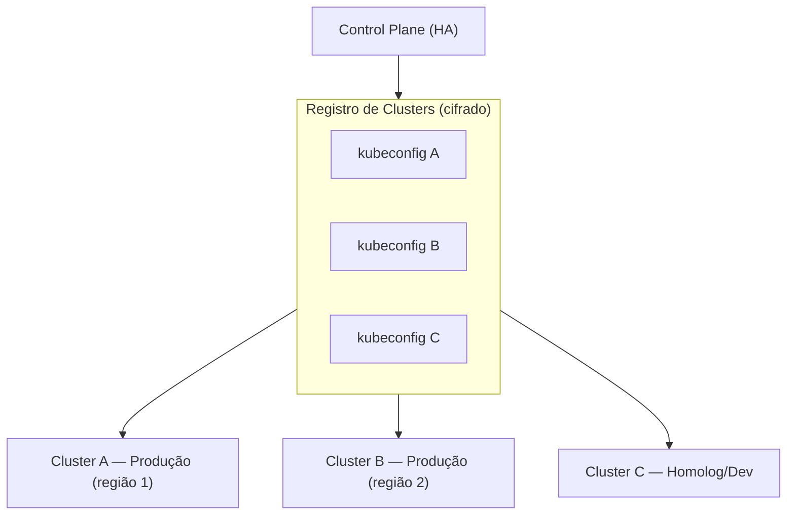

# 10 — Alta Disponibilidade & Multi-Cluster

> Estado de implementação e pendências: [32 — Hardening de produção](./32-hardening-producao.md).

## HA do Control Plane

- Backend **stateless** → N réplicas atrás de load balancer.
- Sessões **persistidas** (Prisma), não em memória → qualquer réplica atende qualquer request.
- Tarefas periódicas (uptime, backups agendados) sob **leader election** por lease no banco
  (`platform_locks`): elas não são idempotentes por execução, então rodam em uma réplica por vez.
- Encerramento gracioso em `SIGTERM`: drena requisições em voo e libera a liderança.
- `/health` (liveness, não toca o banco) separado de `/ready` (readiness, verifica o banco).
- Banco do control plane em HA (Postgres com CloudNativePG/Patroni).
- Reconcilers idempotentes → seguro rodar concorrente (lock otimista por entidade).
- Build/Reconcile como **jobs** assíncronos (fila), permitindo retry.

## HA dos workloads do usuário

- `min ≥ 2` réplicas por padrão em Produção.
- `PodDisruptionBudget` (`maxUnavailable: 1`) + `topologySpreadConstraints` por nó e zona,
  com `ScheduleAnyway` para não travar clusters de nó único — gerados automaticamente.
- Readiness **e** liveness probes derivadas da app (ou defaults sensatos): a readiness tira
  do balanceador, a liveness reinicia processo travado.
- Rollout com `maxUnavailable: 0` + `minReadySeconds` → zero-downtime real.
- Bancos gerenciados em HA via operators (ver [Bancos de Dados](./12-bancos-de-dados.md)).

## Multi-cluster

- Cada **Environment** referencia um **Cluster** + namespace.
- `KubernetesAdapter` instanciado por cluster (credenciais cifradas em repouso).
- **Fleet view:** visão agregada de todos os clusters (capacidade, saúde, custo).
- Estratégias de distribuição:
  - **Ambiente por cluster** (Dev/Homolog/Prod isolados) — padrão, implementado.
  - **Geo-redundância** (mesma app em 2 clusters/regiões) com DNS global (external-dns +
    health-based failover) — 🚧 **projetado, ainda não implementado**.
- Falha de cluster: o control plane continua; deploys são roteados para clusters saudáveis; alertas na Fleet view.

## Backups & DR

- Backups de bancos → **S3 global** (config da org), com retenção e restore por 1 clique — implementado.
- **Velero** para snapshots de PVCs/recursos (incl. restore cross-cluster) — 🚧 **não implementado**;
  backups de volume hoje usam a CRD `Backup` do Longhorn.
- Estratégia de DR documentada por ambiente (RPO/RTO configuráveis por tamanho do banco) — 🚧 pendente.

## Resiliência de deploy

- Zero-downtime por padrão (Argo Rollouts).
- Rollback automático em degradação.
- Quotas e limites por tenant evitam _noisy neighbor_ entre organizações.
