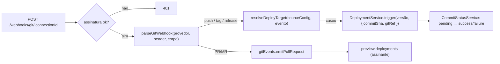

# 36. Eventos Git (push, tag, release, PR/MR) e status do commit

O webhook Git entendia só push. Agora ele normaliza push, tag, release e pull/merge
request de GitHub, GitLab e Gitea, dispara deploy por tag ou release quando a aplicação
pede, publica PR/MR num barramento interno e reporta o andamento do deploy como status
do commit no provedor.

## Fluxo

## Normalização (`@infra/git/webhookEvents`)

Strategy por provedor, com um parser por tipo de evento. O tipo vem do header
(`X-Gitea-Event` > `X-Gitlab-Event` > `X-GitHub-Event`; o Gitea manda também o do
GitHub, por isso o dele vence). Sem header, o tipo é deduzido do corpo
(`object_kind` no GitLab; `pull_request`/`release`/`ref` no GitHub e no Gitea).

| Evento normalizado | GitHub | GitLab | Gitea |
|---|---|---|---|
| `push` | `push` em `refs/heads/*` | `Push Hook` | `push` em `refs/heads/*` |
| `tag` | `push` em `refs/tags/*` | `Tag Push Hook` | `push` em `refs/tags/*` |
| `release` | `release` com `action: published` | `Release Hook` com `action: create` | `release` com `action: published` |
| `pull_request` | `pull_request` | `Merge Request Hook` | `pull_request` / `pull_request_sync` |

Regras que valem para os três:

- Ref apagada (`after` zerado ou `deleted: true`) é ignorada, seja branch ou tag.
- Release em rascunho, editada ou removida não gera versão.
- Ações de PR/MR aceitas: `opened`, `synchronized`, `reopened`, `closed`, `merged`
  (`closed` com `merged: true` vira `merged`). No GitLab, `update` só conta como
  `synchronized` quando traz `oldrev` (push novo); update de título ou label é ignorado.
- Só o GitLab informa o commit da release; GitHub e Gitea trazem apenas a tag.
- Chave que vem de fora (header, `action`, `deployTrigger`) é lida com `strategyFor`,
  que só aceita chaves próprias do mapa (`constructor` não vira parser).

## Gatilho de deploy por aplicação (`@service/git/deployTrigger.strategy`)

Em `sourceConfig`, editável na aba Configurações e no `PATCH /api/applications/:id`:

| Campo | Valores | Efeito |
|---|---|---|
| `deployTrigger` | `branch` (padrão), `tag`, `release` | Qual evento dispara o deploy automático. |
| `tagPattern` | glob com `*` e `?` (ex.: `v*`, `release-2026.*`) | Filtra as tags nos modos `tag`/`release`. Vazio aceita qualquer tag; string vazia no PATCH limpa. |
| `autoDeploy` | `true` (padrão) / `false` | Desligado, nenhum evento dispara. |
| `watchPaths` | prefixos | Só no modo `branch` (o push de tag não traz lista de arquivos). |

O modo `branch` é o comportamento anterior, sem mudança: versão = sha curto (7), branch
padrão `main`, `repo`/`fullName` precisam casar quando informados, `watchPaths` respeitado.
Nos modos tag/release a versão é o nome da tag e o build recebe `gitRef = refs/tags/<tag>`
em `config`.

> Pendência: `backend/src/infra/build/strategies.ts` (fora do versionamento por causa do
> `build/` no `.gitignore`) ainda monta o contexto Kaniko com `refs/heads/<branch>`. Para
> construir a tag, ele precisa preferir `config.gitRef` quando presente.

## Barramento de PR/MR (`@infra/realtime/GitEventBus`)

`gitEvents.emitPullRequest(event)` / `gitEvents.onPullRequest(listener)`, com
`PullRequestEvent` já normalizado (`connectionId`, `organizationId`, `provider`,
`action`, `number`, `title`, `repo`, `sourceBranch`, `targetBranch`, `headSha`,
`author?`, `url?`). O webhook de PR/MR nunca faz deploy direto: quem reage (preview
deployments) assina. Em memória hoje; a mesma interface serve para Redis pub/sub.

## Status do commit (`CommitStatusService`)

`IGitProvider.setCommitStatus(repo, sha, { state, description, targetUrl, context })`:

| Provedor | Endpoint | Estados |
|---|---|---|
| GitHub | `POST /repos/:repo/statuses/:sha` | `pending`, `success`, `failure`, `error` |
| GitLab | `POST /api/v4/projects/:id/statuses/:sha` (`name` = contexto) | `failure` e `error` viram `failed` |
| Gitea | `POST /api/v1/repos/:repo/statuses/:sha` | `pending`, `success`, `failure`, `error` |

O `baseUrl` da conexão vale para GitLab/Gitea self-hosted. O contexto é sempre
`capiva-cloud`.

O `DeploymentService` reporta:

| Momento | Estado | Descrição |
|---|---|---|
| início do `run` | `pending` | Deploy em andamento. |
| pods prontos | `success` | Deploy concluído. |
| health check falhou | `failure` | Deploy falhou. |
| exceção no pipeline | `error` | Erro ao executar o deploy. |

É best-effort: sem sha, sem conexão Git, sem `repo` na app ou com erro do provedor
(token sem escopo, API fora), só fica no log `[commit-status]` e o deploy segue.
`targetUrl` = `PUBLIC_URL/applications/:appId?deployment=:deploymentId`.

O sha completo chega por `DeploymentService.trigger(appId, versão, tenant, commitId?,
{ commitSha, gitRef })`; o rótulo curto da versão continua o mesmo. Deploy manual não tem
sha e não reporta status.

Escopo do token: GitHub `repo:status` (ou `repo`), GitLab `api`, Gitea `write:repository`.

## Comentário no PR/MR

`GitService.commentOnPullRequest(connectionId, repo, number, body, tenant)` cria ou atualiza
o comentário da plataforma. O upsert procura o comentário com o marcador oculto
`<!-- capiva-preview -->` (`PREVIEW_COMMENT_MARKER`) e edita; sem ele, cria. Se o texto
não traz o marcador, ele é acrescentado no topo.

| Provedor | Listar | Criar | Atualizar |
|---|---|---|---|
| GitHub | `GET /repos/:repo/issues/:n/comments` | `POST` mesmo caminho | `PATCH /repos/:repo/issues/comments/:id` |
| GitLab | `GET /api/v4/projects/:id/merge_requests/:iid/notes` | `POST` mesmo caminho | `PUT .../notes/:note_id` |
| Gitea | `GET /api/v1/repos/:repo/issues/:n/comments` | `POST` mesmo caminho | `PATCH /api/v1/repos/:repo/issues/comments/:id` |

## Testes

- `gitWebhookEvents.test.ts`: fixtures reais por provedor em `__tests__/fixtures/git/*.json`.
- `deployTrigger.test.ts`: gatilhos, `tagPattern`, schema do PATCH.
- `gitCommitStatus.test.ts`: HTTP de cada provedor (fetch mockado), mapeamento de estado,
  upsert do comentário e o best-effort do `CommitStatusService`.
