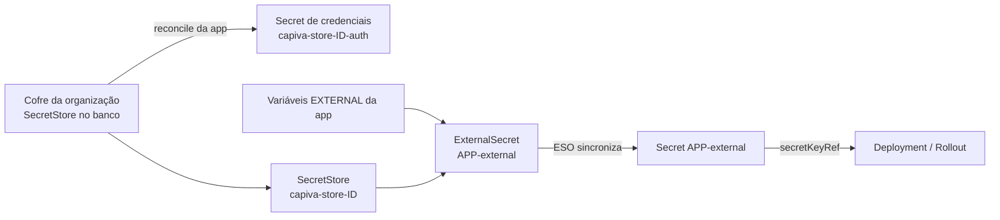

# 41 — NetworkPolicy padrão e External Secrets

Item 2.6 (parte B) do roadmap. Duas peças independentes:

1. **NetworkPolicy padrão por namespace de ambiente**: isolamento de rede ligado
   por padrão, opcional por ambiente.
2. **Cofre externo (External Secrets Operator)**: variável de ambiente cujo valor
   vem de AWS Secrets Manager, HashiCorp Vault ou GCP Secret Manager.

---

## 1. NetworkPolicy padrão

### O que é aplicado

Cada `Environment` tem um namespace (`capiva-<slug>-<org>`). Com
`networkIsolation = true` (padrão) o `NetworkPolicyService` mantém neste
namespace o conjunto abaixo. NetworkPolicies são aditivas: a primeira nega, as
demais só liberam.

| Policy                        | Seleciona            | Efeito                                                                                     |
| ----------------------------- | -------------------- | ------------------------------------------------------------------------------------------ |
| `capiva-default-deny-ingress` | todos os pods        | deny-all de ingress                                                                        |
| `capiva-allow-same-namespace` | todos os pods        | libera tráfego vindo do próprio namespace (apps, bancos, workers, solver do cert-manager)  |
| `capiva-allow-platform`       | todos os pods        | libera os namespaces do ingress controller, do monitoramento e dos operators de banco      |
| `capiva-allow-egress`         | todos os pods        | egress aberto, com regra explícita de DNS (kube-dns, UDP/TCP 53)                           |
| `capiva-deps-<app>`           | pods da `<app>`      | libera as origens de **outro namespace** declaradas em `ServiceDependency` (namespace AND pod) |
| `<db>-ext`                    | pods primários do banco | libera o acesso externo (NodePort) na porta do banco; aplicado pelo `DatabaseReconciler` |

Dependência entre apps do mesmo ambiente já passa pela regra do mesmo namespace,
então `capiva-deps-<app>` só carrega as origens externas. A policy existe para
toda app, mesmo sem regra: o nome é fixo e remover a última dependência
sobrescreve a policy com zero regras em vez de deixar liberação órfã.

Bancos gerenciados rodam no namespace do ambiente: app → banco do mesmo
ambiente é tráfego do mesmo namespace. O operator (CloudNativePG, MySQL, ECK,
RabbitMQ) precisa falar com os pods do banco, por isso o namespace dele está na
lista de plataforma.

### Namespaces da plataforma

| Variável                       | Padrão                                                     |
| ------------------------------ | ---------------------------------------------------------- |
| `CAPIVA_INGRESS_NAMESPACE`     | `kube-system` (Traefik do k3s)                             |
| `CAPIVA_MONITORING_NAMESPACES` | `monitoring` (Prometheus/Loki); vazio desliga               |
| `CAPIVA_OPERATOR_NAMESPACES`   | `cnpg-system,mysql-operator,rabbitmq-system,elastic-system` |

Listas separadas por vírgula. O metrics-server lê o kubelet, não os pods, e não
precisa de regra.

### Quando sincroniza

`NetworkPolicyService.syncEnvironment` é idempotente e roda:

- na criação e na edição do ambiente (inclusive troca de cluster e do
  `networkIsolation`);
- a cada reconcile de aplicação (garante as policies em cluster ligado depois);
- ao conectar ou desconectar uma dependência (no ambiente do **destino**).

Falha de cluster é registrada no log e não desfaz a gravação que disparou a
sincronização.

### Desligar por ambiente

`PATCH /api/environments/:id` com `{ "networkIsolation": false }` (ou a caixa
"Isolamento de rede" em Configurações → Ambientes) remove o conjunto inteiro do
namespace. A policy por app das versões anteriores (`<app>-allow`), que negava
tráfego mesmo sem isolamento, é removida no próximo reconcile da app.

### Código

- `backend/src/infra/kubernetes/networkPolicyManifests.ts`: funções puras
  (`buildTenantNetworkPolicies`, `planTenantNetworkPolicies`, ...).
- `backend/src/service/NetworkPolicyService.ts`: lê ambiente, apps e
  dependências e aplica o plano.
- Testes: `networkPolicy.test.ts`, `networkPolicy.service.test.ts`.
- Migration `20261104120000_environment_network_isolation`.

---

## 2. External Secrets

### Fluxo

1. Em **Configurações → Cofres externos** o admin cadastra o cofre: provedor,
   configuração e credenciais (cifradas em repouso, nunca devolvidas pela API).
2. No editor de variáveis da aplicação, o botão do cofre transforma a linha em
   "do cofre externo": escolhe o cofre, a **chave** e a **propriedade**
   (opcional, campo dentro de um segredo JSON). A plataforma grava só a
   referência: `EnvVar.source = EXTERNAL`, `value` = chave remota,
   `remoteProperty`, `secretStoreId`.
3. No reconcile, o `SecretStoreService`:
   - garante o operator instalado (`OperatorInstallerService.ensure(ctx, "EXTERNAL_SECRETS")`);
   - aplica, para cada cofre usado, o Secret de credenciais e um `SecretStore`
     **namespaced** no namespace do ambiente (nunca `ClusterSecretStore`: o
     cluster é compartilhado entre organizações);
   - aplica um `ExternalSecret` por app (`<app>-external`), uma entrada por
     variável, cada uma com o próprio cofre em `sourceRef.storeRef`;
   - sem variável externa, remove o `ExternalSecret` (o Secret alvo é `Owner` e
     sai junto).
4. O container recebe `valueFrom.secretKeyRef` apontando para o Secret
   sincronizado.

### Provedores (Strategy)

`PROVIDER_STRATEGIES` em `externalSecretManifests.ts` monta o bloco `provider`
e as chaves do Secret de credenciais:

| Provedor              | Config                               | Credenciais                          |
| --------------------- | ------------------------------------ | ------------------------------------ |
| `AWS_SECRETS_MANAGER` | `region`                             | `accessKeyId`, `secretAccessKey`     |
| `VAULT`               | `server`, `path`, `version` (v2)     | `token`                              |
| `GCP_SECRET_MANAGER`  | `projectId`                          | `serviceAccountJson`                 |

Provedor novo: valor no enum Prisma `SecretStoreProvider`, uma entrada no mapa
de strategies, um ramo na união do `createSecretStoreSchema` e os campos em
`PROVIDER_FIELDS` do `SecretStoreDrawer`.

### Instalação do operator

Pelo mecanismo de operators existente: `OPERATORS.EXTERNAL_SECRETS` aplica um
`HelmChart` do k3s (`helm.cattle.io/v1`, chart `external-secrets` do repositório
`https://charts.external-secrets.io`, namespace `external-secrets`, CRDs
incluídos). Só é instalado quando uma app usa variável do cofre. A versão do
chart pode ser fixada com `CAPIVA_ESO_CHART_VERSION`; sem ela, instala a mais
recente. Os manifests usam a API `external-secrets.io/v1`.

### API

| Método | Rota                       | Descrição                                     |
| ------ | -------------------------- | --------------------------------------------- |
| GET    | `/api/secret-stores`       | lista (sem credenciais)                       |
| GET    | `/api/secret-stores/:id`   | detalhe (sem credenciais)                     |
| POST   | `/api/secret-stores`       | cadastra (ADMIN)                              |
| DELETE | `/api/secret-stores/:id`   | remove e apaga os `SecretStore` materializados (ADMIN) |
| PUT    | `/api/applications/:id/env` | itens aceitam `external: { secretStoreId, remoteKey, remoteProperty }` |

Migration `20261104130000_external_secret_stores` (modelo `SecretStore`, enum
`SecretStoreProvider`, `EnvVarSource.EXTERNAL`, colunas `secretStoreId` e
`remoteProperty` em `env_vars`).

### Limites conhecidos

- O HelmChart só existe em k3s. Em cluster conectado de outra distribuição,
  instale o operator antes (Helm) e a plataforma detecta o CRD.
- Na primeira app com variável externa o operator ainda está subindo: o
  `SecretStore` falha (CRD ausente), fica registrado no log e entra no próximo
  reconcile.
- Workers e CronJobs ainda não leem variáveis do cofre (só aplicações).
- Remover um cofre zera o `secretStoreId` das variáveis (FK `SET NULL`): elas
  saem do container no próximo reconcile e o editor pede outro cofre.
