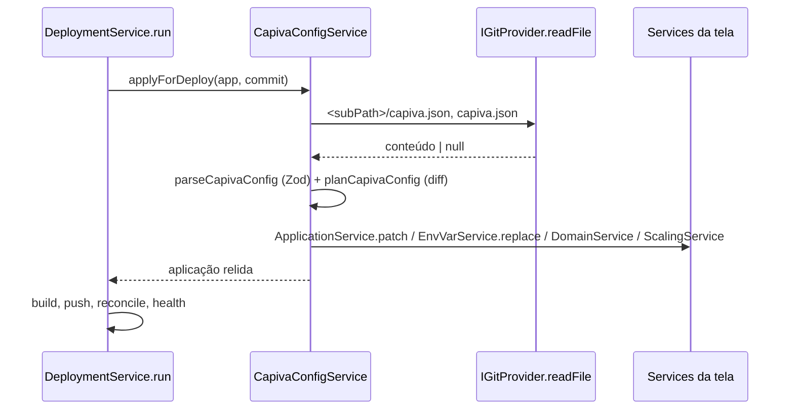

# 44 — Infra como código (`capiva.json`) e CLI `capiva`

Duas formas de operar uma aplicação sem abrir o painel:

- **`capiva.json`**: arquivo versionado no repositório que declara build, porta,
  health check, recursos, réplicas, autoscaling, variáveis não secretas, volumes e
  domínios. Lido a cada deploy, no commit que está sendo deployado.
- **CLI `capiva`**: binário que fala com a API usando uma chave `cap_` (listar apps,
  deploy acompanhando o progresso, logs, variáveis, rollback e gerar o `capiva.json`).

## `capiva.json`

### Onde fica

Na raiz do repositório **ou** no diretório da aplicação, num monorepo. O backend procura
primeiro em `<subPath>/capiva.json` (o "Contexto de build" das Configurações, ver
[33](./33-configuracao-de-build.md)) e depois em `capiva.json` na raiz. O primeiro
encontrado vale.

Só aplicações de origem Git (GitHub, GitLab, Gitea) com conexão Git leem o arquivo. A
leitura usa a API do provedor no `ref` do deploy: o commit, quando o deploy o informa,
ou a branch configurada.

### Exemplo completo

```json
{
  "$schema": "https://capiva.suaempresa.com/schemas/capiva.json",
  "build": {
    "type": "GITHUB",
    "dockerfile": "Dockerfile.prod",
    "context": "apps/api",
    "buildCommand": "bun run build",
    "startCommand": "bun start",
    "args": { "NODE_ENV": "production" }
  },
  "port": 8080,
  "healthcheck": { "path": "/health" },
  "profile": "MEDIUM",
  "replicas": 2,
  "autoscaling": { "min": 2, "max": 6, "metric": "CPU", "target": 70 },
  "env": { "LOG_LEVEL": "info", "FEATURE_X": "true" },
  "volumes": [{ "name": "uploads", "mountPath": "/data/uploads", "sizeGi": 5, "accessMode": "RWO" }],
  "domains": ["api.suaempresa.com"]
}
```

Mínimo útil (só o que você quer travar no repositório):

```json
{
  "$schema": "https://capiva.suaempresa.com/schemas/capiva.json",
  "port": 3000,
  "healthcheck": { "path": "/health" }
}
```

### Campos

| Campo | Vira | Observação |
|---|---|---|
| `build.type` | — | Precisa ser igual à origem da aplicação. Diferente = deploy falha. |
| `build.dockerfile` | `sourceConfig.dockerfile` | Caminho relativo; `..` e barra inicial são recusados (`repoPathSchema`). |
| `build.context` | `sourceConfig.subPath` | Contexto de build (monorepo). |
| `build.compose` | `sourceConfig.compose` | Origem Docker Compose. |
| `build.buildCommand` / `startCommand` | `sourceConfig.buildCommand` / `startCommand` | Lidos pelos builders que usam comando. |
| `build.args` | build args | Substitui a lista inteira de build args. |
| `port` | `port` | 1 a 65535. |
| `healthcheck.path` | `sourceConfig.healthPath` | Começa com `/`. |
| `profile` | `profile` | `NANO`, `SMALL`, `MEDIUM`, `LARGE`, `XLARGE`, `CUSTOM`. |
| `replicas` | `sourceConfig.replicas` | Réplicas desejadas sem autoscaling (0 a 100). Padrão continua 2. |
| `autoscaling` | política de HPA | `min`, `max`, `metric` (`CPU`/`MEMORY`/`REQUESTS`, padrão `CPU`), `target`. |
| `env` | variáveis MANUAL | **Somente não secretas.** Segredos continuam na tela. |
| `volumes` | volumes | Cria os que faltam; **nunca remove** (apagar volume destrói dados). |
| `domains` | domínios | A lista do arquivo é a lista inteira: adiciona os novos e remove os que sumiram. |

Os objetos são **estritos**: chave desconhecida (`"prot": 3000`) é erro, não um campo
ignorado em silêncio.

### Precedência

O que o arquivo **declara** vence a tela. O que ele não declara continua vindo da tela.

- Variáveis: as chaves do arquivo sobrescrevem as da tela; as demais (inclusive os
  segredos) ficam como estão. Variáveis injetadas por dependência nunca são tocadas.
- Só vira escrita o que **difere** do estado atual: um deploy com o arquivo inalterado
  não regrava nada nem reconcilia a mais.
- A tela marca os campos vindos do arquivo com o selo `capiva.json` e os deixa somente
  leitura (Configurações, Variáveis, Domínios, Escala, Volumes). A marca fica em
  `sourceConfig.capivaJson` (`path`, `ref`, `fields`, `envKeys`) e é limpa quando o
  arquivo some do repositório.

### Como entra no deploy



- A aplicação do arquivo passa pelo **mesmo fluxo de services** que a tela usa (sem
  caminho paralelo): cada action do plano (`CapivaAction`) tem um executor que chama o
  service correspondente. Planejamento puro em `@service/capivaConfig.strategy`.
- **Arquivo inválido**: o deploy falha **antes** de qualquer escrita, com a mensagem do
  Zod na timeline (ex.: `capiva.json inválido: port: Porta deve estar entre 1 e 65535.`).
  O rollback automático **não** roda nesse caso: nada no ar foi tocado.
- Falha ao ler o arquivo na API do provedor também para o deploy (o build clonaria o
  mesmo repositório e falharia de qualquer jeito).

### JSON Schema (autocompletar no editor)

`GET /schemas/capiva.json` (público, sem autenticação) devolve o JSON Schema gerado do
mesmo schema Zod que valida o arquivo (`buildCapivaJsonSchema` em
`@schemas/capivaConfig.schema`). Aponte o `$schema` do arquivo para essa URL. O nginx do
deploy padrão encaminha `/schemas/` ao backend. Documentado no OpenAPI (`/docs`).

### `readFile` nos provedores Git

`IGitProvider.readFile(repo, ref, path): Promise<string | null>` (404 = `null`), respeitando
o `baseUrl` da conexão (GitHub Enterprise, GitLab e Gitea self-hosted):

| Provedor | Endpoint |
|---|---|
| GitHub | `GET /repos/{repo}/contents/{path}?ref={ref}` |
| GitLab | `GET /api/v4/projects/{repo codificado}/repository/files/{path codificado}?ref={ref}` |
| Gitea | `GET /api/v1/repos/{repo}/contents/{path}?ref={ref}` |

## CLI `capiva`

Pacote `cli/` (Bun + TypeScript, sem dependências de runtime). Cada comando é uma
Strategy registrada em `COMMANDS` (`cli/src/commands/registry.ts`); o despacho tenta o
comando de duas palavras (`apps list`) antes do de uma (`deploy`).

### Instalação

```bash
bun run build:cli            # gera cli/dist/capiva (binário único, bun build --compile)
sudo mv cli/dist/capiva /usr/local/bin/
# ou, sem compilar:
bun cli/src/index.ts --help
```

### Autenticação

Crie uma chave de API (`cap_...`) no painel, em Organização, API Keys. Depois:

```bash
capiva login --api-url https://capiva.suaempresa.com --token cap_xxxx_yyyy
```

A chave é validada na API e gravada em `~/.config/capiva/config.json` (respeita
`XDG_CONFIG_HOME`), diretório 700 e arquivo 600. Em CI, use variáveis de ambiente, que
vencem o arquivo:

```bash
export CAPIVA_API_URL=https://capiva.suaempresa.com
export CAPIVA_TOKEN=cap_xxxx_yyyy
```

A organização é a da chave (não precisa de `x-organization-id`).

### Comandos

| Comando | O que faz | Endpoints |
|---|---|---|
| `capiva apps list` | Lista as aplicações da organização | `GET /projects`, `GET /applications?projectId=` |
| `capiva apps status <app>` | Estado e último deploy | `GET /applications/:id`, `GET /applications/:id/deployments` |
| `capiva deploy <app> [--wait]` | Dispara deploy; `--wait` acompanha até o fim (sai com 1 se falhar) | `POST /applications/:id/deploy`, SSE `GET /streams/deployments/:id` |
| `capiva logs <app> [-f]` | Logs recentes; `-f` segue sem repetir linhas | SSE `GET /streams/applications/:id/logs` |
| `capiva env list <app>` | Variáveis (segredos mascarados) | `GET /applications/:id/env` |
| `capiva env set <app> K=V... [--secret]` | Cria/altera variáveis, preservando as demais e os segredos | `GET` + `PUT /applications/:id/env` |
| `capiva env unset <app> KEY` | Remove uma variável | `DELETE /applications/:id/env/:key` |
| `capiva rollback <app> [deployId]` | Volta para o deploy informado ou para o saudável anterior ao atual | `POST /applications/:id/rollback` |
| `capiva init <app> [--force]` | Gera `./capiva.json` (com `$schema`) a partir da aplicação, sem segredos | `GET` app, env, domains, volumes, scaling |

`<app>` aceita o nome ou o id. Nome repetido em projetos diferentes pede o id. Toda saída
tem versão `--json` (em `logs`, uma linha JSON por log).

### Exemplos

```bash
capiva apps list
capiva apps list --json | jq '.[].name'

capiva deploy api --wait
#   5%  capiva.json aplicado (apps/api/capiva.json)
#  10%  Build iniciado
#  40%  Imagem publicada
# 100%  Health Check OK

capiva logs api -f
capiva env set api LOG_LEVEL=debug FEATURE_X=true
capiva env set api STRIPE_KEY=sk_live_xxx --secret
capiva env unset api FEATURE_X
capiva rollback api
capiva init api && git add capiva.json && git commit -m "infra: capiva.json"
```

Códigos de saída: `0` sucesso, `1` erro (API, deploy falhou, app não encontrada), `2`
uso incorreto.

### Streams SSE com chave de API

`sseAuthMiddleware` passou a aceitar `Authorization: Bearer cap_...` (antes só aceitava
JWT de sessão), igual ao `authMiddleware`. É o que permite `deploy --wait` e `logs -f`.

## Arquivos

| Onde | O quê |
|---|---|
| `backend/src/schemas/capivaConfig.schema.ts` | Schema Zod, `parseCapivaConfig`, `CapivaConfigError`, JSON Schema |
| `backend/src/service/capivaConfig.strategy.ts` | Merge de precedência por seção (puro) |
| `backend/src/service/CapivaConfigService.ts` | Leitura no Git + execução pelos services da tela |
| `backend/src/http/routes/web/schemas/index.ts` | `GET /schemas/capiva.json` |
| `backend/src/infra/git/providers.ts` | `readFile` por provedor |
| `frontend/src/lib/capivaJson.ts`, `CapivaJsonNotice.tsx` | Selo e aviso "definido pelo capiva.json" |
| `cli/` | CLI `capiva` |

Testes: `backend/src/__tests__/capivaConfig.*.test.ts`, `gitProviders.readFile.test.ts`,
`sseAuth.apiKey.test.ts`, `applicationPatch.capiva.test.ts`, `capivaSchemaRoute.test.ts`;
`cli/src/__tests__/` (`bun test` em `cli`); `frontend/src/lib/capivaJson.test.ts`.
